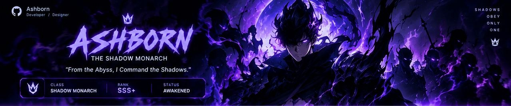

 

<table width="100%">
<tr>
<td width="31%" valign="top">

### 👑 MONARCH PROFILE

**Ashborn** 
Developer / Designer

 

I build digital worlds, craft seamless experiences and turn ideas into reality. Driven by curiosity, fueled by anime, and obsessed with clean code & creative design.

**🎯 CURRENT FOCUS** 
Web Development / UI/UX Design / Open Source

**💜 INTERESTS** 
Gaming / Anime / Tech / Design / Problem Solving

**🧭 PHILOSOPHY** 
*"Better Code. Better Ideas. A Greater Tomorrow."*

</td>
<td width="38%" valign="top">

### 🗡️ SHADOW ARSENAL
TOOLS OF A SHADOW MONARCH

**LANGUAGES** 

**FRAMEWORKS & LIBRARIES** 

**DATABASES** 

**TOOLS & OTHERS** 

</td>
<td width="31%" valign="top">

### ⚡ SYSTEM ATTRIBUTES
GITHUB STATS & ACTIVITY

</td>
</tr>
</table>

 

### 👑 THE SHADOW ARMY
FEATURED PROJECTS / REPOSITORIES — *Different missions. Same goal.*

<table width="100%">
<tr>
<td width="25%" valign="top">

**TotalGaming Esports Website** 
Official esports website for TotalGaming Esports with news, tournaments, team & more.

   

⭐ 12 &nbsp; 🍴 3 
[View Repository →](https://github.com/YOUR_USERNAME/TotalGaming-Web)

</td>
<td width="25%" valign="top">

**The.God Portfolio** 
Personal portfolio website with modern design, smooth animations and clean UI.

   

⭐ 8 &nbsp; 🍴 2 
[View Repository →](https://github.com/YOUR_USERNAME/The.God-Portfolio)

</td>
<td width="25%" valign="top">

**Gaming Community Platform** 
A community platform for gamers with chat, events and tournaments.

   

⭐ 15 &nbsp; 🍴 4 
[View Repository →](https://github.com/YOUR_USERNAME/Gaming-Community-Platform)

</td>
<td width="25%" valign="top">

**AI Web Assistant** 
Smart AI assistant with modern UI and real-time responses.

   

⭐ 9 &nbsp; 🍴 1 
[View Repository →](https://github.com/YOUR_USERNAME/AI-Web-Assistant)

</td>
</tr>
</table>

 

### 🚪 GATES & MISSIONS
CURRENT GOALS & QUEST TRACKER — *Small steps. Big realms.*

 

<table width="100%">
<tr>
<td width="62%" valign="top">

### 🛡️ THE MONARCH'S RECORD
ACTIVITY & ACHIEVEMENTS

</td>
<td width="38%" valign="top">

**Recent Activity**

🟣 Pushed to **TotalGaming-Web** — *2h ago* 
🔀 Created new branch — *5h ago* 
✅ Merged pull request — *1d ago* 
🎯 Opened issue — *2d ago*

**🏆 Featured Achievement** 
**First Pull Request** — Merged your first pull request *(Jan 15, 2025)*

</td>
</tr>
</table>

 

### FOLLOW THE SHADOW

  

*Power is not inherited.* 
**It is awakened in the shadows.** 
— Ashborn

